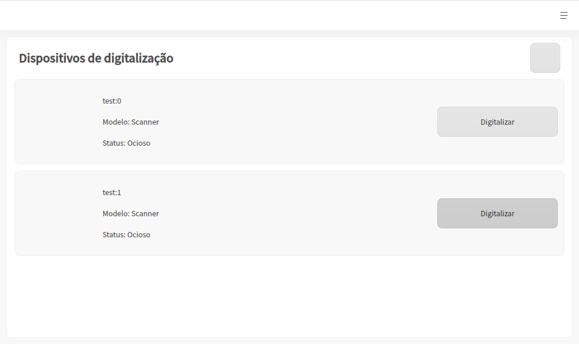
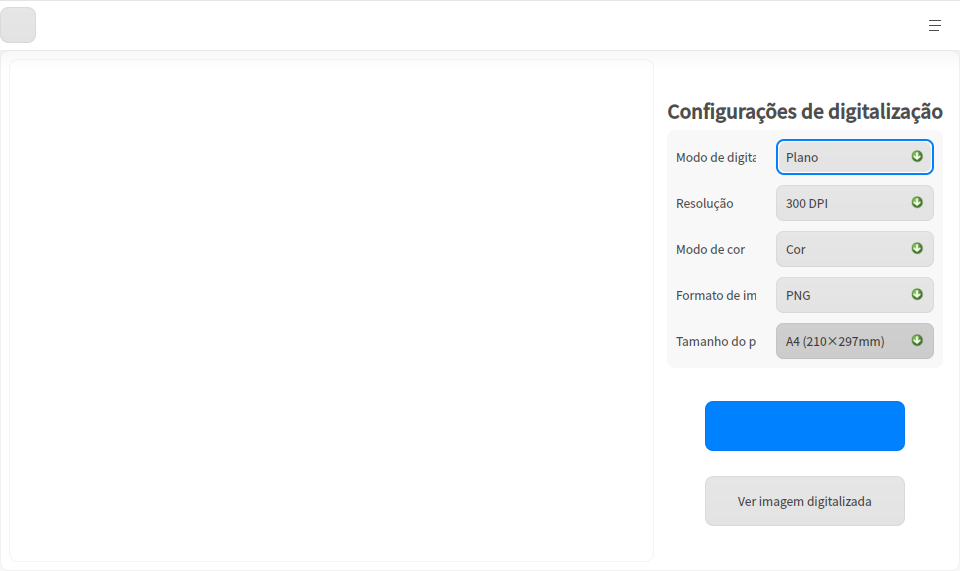

# Gerenciador de Scanner|deepin-scanner|

## Visão Geral
O Gerenciador de Scanner é uma ferramenta para gerenciar dispositivos de digitalização, capaz de gerenciar múltiplos dispositivos de digitalização simultaneamente. A interface é visual e a operação é simples.

## Primeiros Passos
Você pode iniciar ou fechar o Gerenciador de Scanner, ou criar um atalho, das seguintes maneiras.
### Iniciar o Gerenciador de Scanner
1.  Clique no ícone do Iniciador  na barra de tarefas para acessar o Iniciador de Aplicativos.
2.  Role a roda do mouse para cima e para baixo para navegar ou pesquise para encontrar o Gerenciador de Scanner  e clique para executá-lo.
3.  Clique com o botão direito em  e você poderá:
*   Clicar em **Enviar para a área de trabalho** para criar um atalho na área de trabalho.
*   Clicar em **Fixar na barra de tarefas** para fixar o aplicativo na barra de tarefas.
*   Clicar em **Iniciar automaticamente na inicialização** para adicionar o aplicativo aos itens de inicialização, de modo que seja executado automaticamente ao ligar o computador.

### Fechar o Gerenciador de Scanner
*   Clique em  na janela do Gerenciador de Scanner para sair.
*   Clique com o botão direito em  na barra de tarefas e selecione **Fechar tudo** para sair do Gerenciador de Scanner.
*   Clique em  na janela do Gerenciador de Scanner e selecione **Sair** para fechar o aplicativo.

## Introdução às Operações de Digitalização
Conecte o dispositivo de digitalização ao computador e ligue o interruptor do dispositivo.
Abra o Gerenciador de Scanner e o sistema detectará automaticamente todos os dispositivos de digitalização conectados ao computador atual, como câmeras e scanners. Se a lista de dispositivos correspondente não for exibida, será necessário instalar o driver.

### Instalar o Driver
1.  Baixe o pacote de instalação do driver .deb correspondente ao dispositivo de digitalização no site oficial.
2.  Dê um clique duplo no pacote de instalação do driver; o instalador de pacotes de software será iniciado automaticamente e preparará a instalação.
3.  Após a instalação bem-sucedida do driver, clique no botão atualizar  para confirmar se o dispositivo é exibido na lista.

### Câmera
1.  Selecione a câmera na lista de dispositivos e clique em **Digitalizar** para entrar na tela de digitalização.
2.  Defina os parâmetros de digitalização no lado direito da tela, incluindo configurações de digitalização, corte e esquemas de processamento de imagem.
    **Configurações de Digitalização**: Defina a resolução, o modo de cor e o formato de imagem da imagem digitalizada. Atualmente, há suporte para três modos de cor (Colorido / Escala de cinza / Preto e branco), quatro formatos de imagem (JPG / BMP / TIF / PNG) e também para digitalização em documentos PDF e OFD.
    
3.  Após concluir as configurações, clique no botão de digitalização ; as imagens digitalizadas poderão ser visualizadas em "Visualizar Imagens Digitalizadas".

## Menu Principal
No menu principal, você pode alternar o tema da janela, visualizar o manual de ajuda, etc.

### Tema
O tema da janela inclui Tema Claro, Tema Escuro e Tema do Sistema.
1.  Na página do Gerenciador de Scanner, clique em .
2.  Clique em **Tema** e selecione uma cor de tema.

### Ajuda
1.  Na página do Gerenciador de Scanner, clique em .
2.  Clique em **Ajuda** para visualizar o manual do usuário e compreender melhor o funcionamento do Gerenciador de Scanner.

### Sobre
1.  Na página do Gerenciador de Scanner, clique em .
2.  Clique em **Sobre** para visualizar a versão e a apresentação do Gerenciador de Scanner.

### Sair
1.  Na página do Gerenciador de Scanner, clique em .
2.  Clique em **Sair**.
